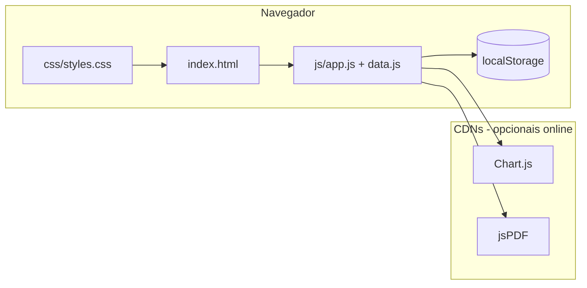

# DataShield — Detector Educativo de Riscos à Privacidade

> **Rascunho genérico:** este README descreve o projeto em nível acadêmico. A equipe deve revisar e ajustar textos, prints e links antes da apresentação.

Site educativo para avaliação anônima de hábitos digitais, painel de risco, simulador de incidentes, orientações resumidas e **cartilha digital em seção própria** (*Escudo Digital: Proteja Seus Dados!*).  
Fundamentação legal de referência: **LGPD**, Arts. 6º, 46 a 50.

**Integrantes:** David Neves, Samia Albuquerque, Jhemerson Conde, Heitor Sales, Joao Paulo, John.

---

## Visão geral

| Produto | Descrição |
|--------|-----------|
| **Site interativo** | Questionário, pontuação (baixo/médio/alto), gráficos, simulador, recomendações e exportação de relatório em PDF (somente resultado da avaliação). |
| **Cartilha digital** | Conteúdo informativo completo apenas na seção **Cartilha**; não duplicado nas demais seções. Material de apoio: `scr/doc/folder_informativo_seguranca_digital_triptico.pptx`. |

O sistema **não solicita senhas reais** e mantém respostas do questionário apenas no navegador (`localStorage`), sem envio a servidor.

---

## Arquitetura

Aplicação **100% estática** (HTML, CSS e JavaScript), executada no navegador do usuário. Não há camada de servidor nem persistência centralizada.



| Aspecto | Decisão |
|--------|---------|
| **Frontend** | Página única com âncoras (`#inicio`, `#questionario`, `#painel`, `#simulador`, `#orientacoes`, `#cartilha`). |
| **Backend / API** | **Não utilizado.** Não existem pastas `app/api`, `routes`, `server` ou equivalentes. |
| **Banco de dados** | **Não utilizado.** Sem Postgres, SQLite, Firebase etc. nas dependências. |
| **Estado** | Respostas do questionário em `localStorage` (chave `datashield_answers_v1`). |
| **Gráficos / PDF** | Chart.js e jsPDF carregados por CDN no `index.html` (requer internet na primeira carga). |
| **Cartilha** | Conteúdo renderizado a partir de `js/data.js` (`CARTILHA_CONTENT`); arquivo PPTX disponível para download em `scr/doc/`. |

### Por que não há API nem banco?

O escopo pede avaliação **anônima** e educativa, sem tratamento de dados pessoais em servidor. Toda a lógica de pontuação, gráficos, simulador e geração de PDF roda em **client-side**, alinhado ao princípio de minimização (LGPD, art. 6º).

---

## Estrutura do repositório

O layout **não** segue frameworks como Next.js ou Express; é um projeto front-end estático simples.

```
DataShield-html-css-js/
├── index.html          # Página principal e navegação por seções
├── css/
│   └── styles.css      # Estilos (paleta ~60% branco, 30% azul, 10% verde)
├── js/
│   ├── data.js         # Perguntas, simulador, cartilha, textos de apoio
│   └── app.js          # Questionário, painel, charts, simulador, PDF
├── scr/
│   └── doc/
│       └── folder_informativo_seguranca_digital_triptico.pptx
├── .gitattributes
└── README.md
```

---

## Tecnologias

- **HTML5**, **CSS3**, **JavaScript** (vanilla, sem build obrigatório)
- **Chart.js** (gráficos no painel)
- **jsPDF** (relatório educativo de risco em PDF)
- **Google Fonts** — DM Sans

Não há `package.json`, Docker nem pipeline CI no repositório nesta versão.

---

## Como executar localmente

1. Clone o repositório.
2. Abra `index.html` no navegador (duplo clique ou arrastar para a janela).
3. **Recomendado:** servir por HTTP local para evitar restrições de alguns navegadores (ex.: Live Server no VS Code/Cursor, ou `npx serve .` se tiver Node instalado).
4. Para gráficos e PDF, mantenha conexão com a internet (CDNs).

---

## Seções do site

| Seção | Função |
|-------|--------|
| Início | Apresentação, LGPD, integrantes |
| Questionário | Avaliação de hábitos (8 perguntas) |
| Painel | Nível de risco, gráficos, recomendações personalizadas |
| Simulador | Cenários educativos (phishing, Wi-Fi, anexo, incidente) |
| Orientações | Resumos; detalhes na cartilha |
| Cartilha | Conteúdo integral *Escudo Digital* + download do PPTX |

---

## LGPD e privacidade

- Não coletamos nomes, e-mails ou senhas.
- Dados do questionário ficam no dispositivo do usuário.
- Uso **educacional**; não substitui política de segurança corporativa nem assessoria jurídica.

---

## Licença e uso acadêmico

Projeto desenvolvido para fins de ensino (Segurança da Informação / PROJETO 02). Definir licença formal se o trabalho for publicado além do ambiente escolar.

---

## Checklist antes da apresentação (equipe)

- [ ] Revisar textos da cartilha e do questionário
- [ ] Testar questionário → painel → exportar PDF
- [ ] Testar simulador em desktop e celular
- [ ] Confirmar download do PPTX em `scr/doc/`
- [ ] Atualizar este README com links do deploy (se houver GitHub Pages ou hospedagem)